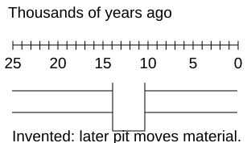
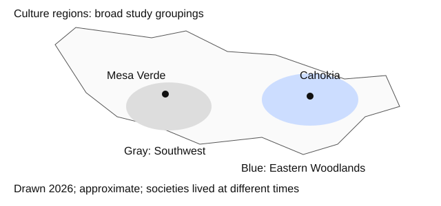
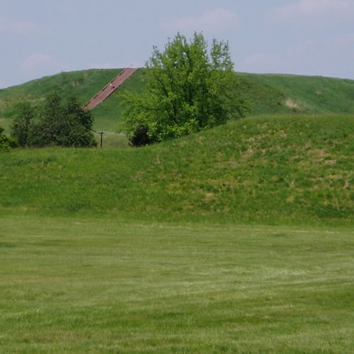

# Unit 3 assessment

Name: __________________

## Side 1

A, Pigati's team, 2023: White Sands footprints, about 21,000 to 23,000 years old.
Recorded layers, seeds, pollen and sediment dating inform this research.

B, Pedersen's team, 2016: food-supporting corridor conditions by about 12,600 years ago.
Researchers sampled one bottleneck.

Original research summaries; 58A, 58A2 and 58B. Paraphrase only.

Place A and B on the timeline.

____________________________

Compare inland and coastal possibilities using A and B.

____________________________

Does depth alone date finds in the pit diagram?

____________________________

Map, Curio Class, 2026: gray Southwest; blue Eastern Woodlands.
Approximate study groupings compare different places and times.

B: Russell Cave. C: Joshua Tree. D: Cahokia. E: Mesa Verde.

B 

C 

D 

E 

Photographs: National Park Service, undated, public domain.

Locate both sites using the map.

____________________________

Identify B using one visible detail.

____________________________

Identify C using one visible detail.

____________________________

Identify D using one visible detail.

____________________________

Identify E using one visible detail.

____________________________

<h2 style="break-before:page">Side 2</h2>

### Q2, continued

What does large construction suggest about work?

____________________________

Does the map's shading mark national borders?

____________________________

### Q3

S, invented: pottery and stored crops beside house floors.
T, invented: repeated building alignment compared with seasonal sunrise observations.

How do recorded digs strengthen theories?

____________________________

What do artifacts and organic traces contribute?

____________________________

Why compare climate and dating evidence with specialists?

____________________________

What could S suggest about settlement?

____________________________

What could T suggest about seasonal observation?

____________________________

Mesa Verde National Park; Cahokia Mounds State Historic Site.

Pueblo cultural center: distinct communities today. Osage Nation: ancestral Cahokia connections.
Original public summaries: undated and 2013; 42C and 53E.

Photos: NPS, public domain; Northfielder, CC BY 2.0, https://creativecommons.org/licenses/by/2.0/. Undated.

Explain each named place's contribution to American history.

____________________________

Why protect evidence and respect descendants' connections?

____________________________

Answer our unit question with a claim, reasons and a limit.

Support your claim using distinct details from two named makers.

Explain why an accurate answer matters to another person.

____________________________

