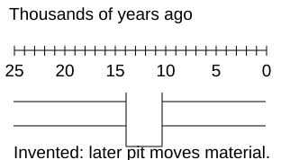
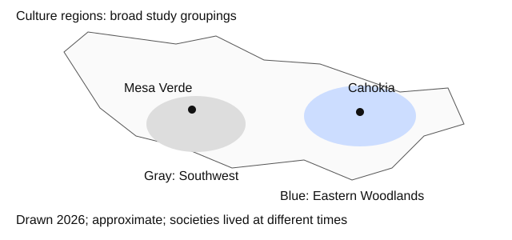
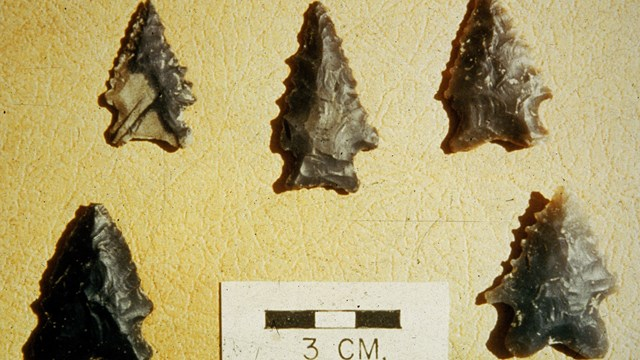
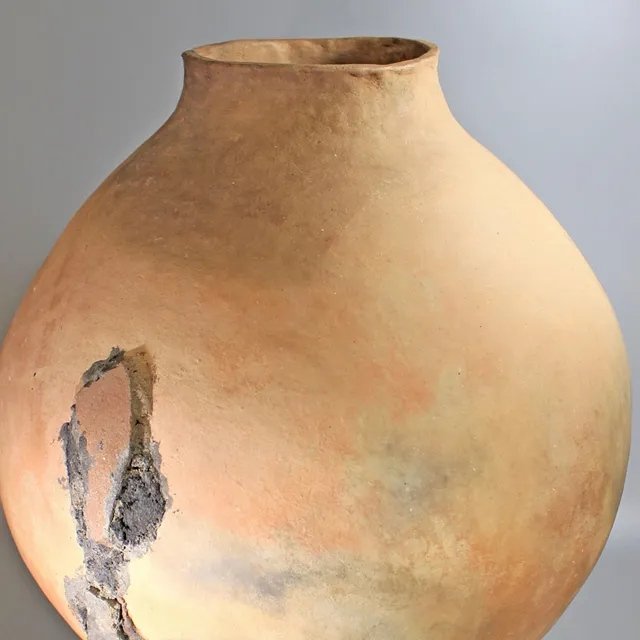
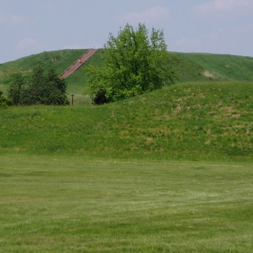
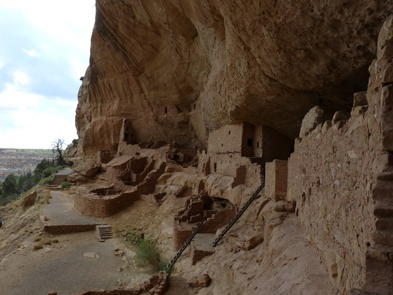
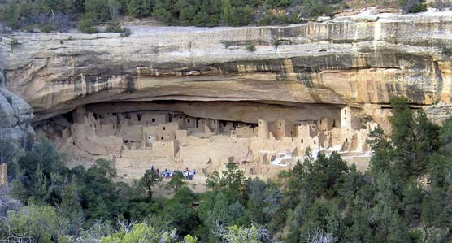
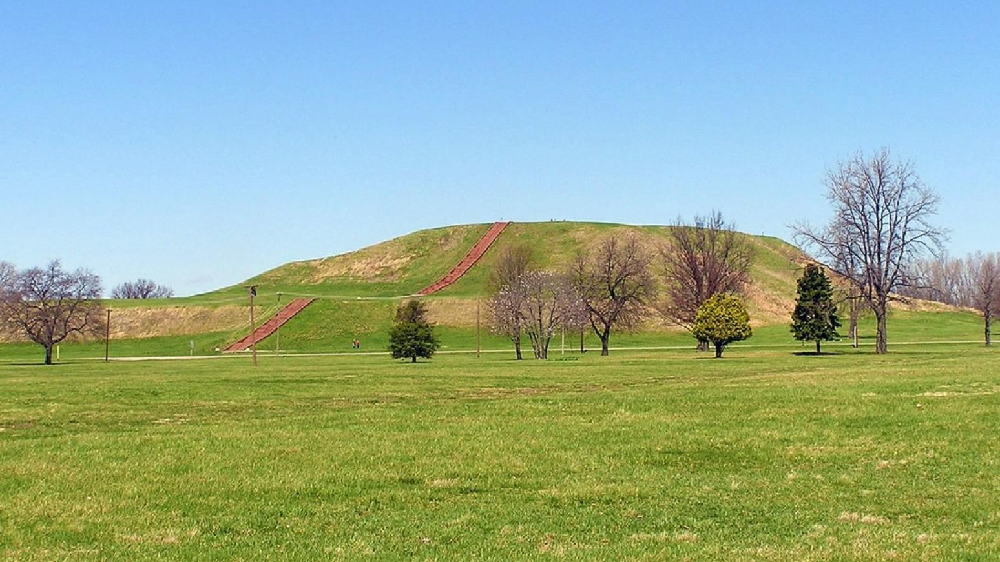

# Day 58: Using unseen evidence

## Teacher page
### Before class
Print today's student page; assessment.md is the separate teacher administration reference. Its map is called Map, distinct from photograph C. Read today's data answer key and teacher-key.md before class. Prepare the private component record. Day 57 tickets select access supports only. Keep every source unseen until this lesson.

### The day
#### 4 min. Read packet
Read sources and directions neutrally to the class. Review skills are assessed independently today, without a content recap. Offer agreed enlarged print or child-directed scribing. The two unlabeled strips S/T and disturbed-pit diagram are invented. Explain only where responses go, not interpretations. Children work alone throughout; no public answer turns.

#### 7 min. Assessment Q1
Give [[s03-A1a]] [[s03-A1b]] [[s03-A1c]]. Sample chronology, competing route explanations and disturbed context. Accept plotted ranges and qualified alternatives. Do not prompt a route choice. The supplied dates permit a comparison, not proof of a journey.

#### 8 min. Assessment Q2
Give [[s03-A2a]] through [[s03-A2g]]. Sample broad regions, four visible material identifications, bounded work inference and the distinction from political borders. Read neutral photo labels if requested, without naming a material or its use. Photograph C is a plain jar; do not require a painted design.

#### 8 min. Assessment Q3
Give [[s03-A3a]] through [[s03-A3e]]. Sample context records, artifact/organic contributions, independent specialist checks, settlement inference and seasonal observation. Statements S/T are separate invented stimuli. No task asks for private beliefs.

#### 4 min. Assessment Q4
Give [[s03-A4a]] [[s03-A4b]]. Sample both preserved sites' distinct contributions and respect for continuing relationships. Homes and earthworks are sufficient visible contributions; do not demand farming from the photograph.

#### 9 min. Assessment Q5
Give [[s03-A5a]] [[s03-A5b]] [[s03-A5c]] as one paragraph and its reader explanation. Score claim/reasoning separately from multiple-source support; never count a claim twice. Makers Pigati and Pedersen provide distinct usable evidence. Collect all papers; no additional exit. After class allow six minutes per child, three hours for thirty. Use shown, shown with help, not yet seen per look-for; access and content help separately. Leave unobserved cells blank. Return all papers on day 59.

### Other rooms
No screen: individual print holds every stimulus. No printer: use the local packet images on a display and hand-copy stems. Give personal response paper; retain all labels and dates. Do not substitute drawings for photographs.

### At home
**Swap.** No printer: show the local images and copy response stems onto paper.
**Skip.** Class collection and public record.
- **40 min. Assessment.** Give today's packet independently in order: questions 1 to 5. Read source words neutrally. Do not explain evidence or give hints. Your child may direct you to write their exact response. Keep the teacher answer key hidden until finished.
  **Say.** "Show where your answer goes." Expect the blank under the item; give no content hints.
- **5 min. Review privately.** Consult today's answer key, choose one next move and keep it for day 59. Do not rehearse the fresh response cards.

### Shorter or longer
Protect all five questions. If access needs more time, record extra time privately; omit no component and give no coached extension.

### Words and supports
Use only neutral reading, visible-shape descriptions and verbatim scribing. Prior vocabulary is not retaught during the check.

### Tomorrow
Day 59 returns day 58's assessment and day 57 papers. Route errors A/B/C/J/K to Chronology/routes, D/E/F/O/P to Evidence/methods, G/L/M to Continuity, H/I/N to Claim/source support. Choose one priority per child. Four sequential meetings and paper retries reach everyone.

### Credit
Ours. Factual source rows: 58A, 58A2, 58B, 49A, 58D, 42B, 53E. Image rights: s03-IMG12 to s03-IMG15, s03-IMG17 and s03-IMG18. Photograph credits accompany child print.

## Student page
### Side 1
**How do we know about people who lived here thousands of years ago?**

A: Pigati's geological team, 2023: White Sands footprints, about 21,000 to 23,000 years old.
Seeds, pollen and sediment dating inform the work.
B: Pedersen's team, 2016: food-supporting corridor conditions by about 12,600 years ago.
One bottleneck was sampled. Public research summaries.

[[s03-A1a]]
[[s03-A1b]]
________________________________________
________________________________________
[[s03-A1c]] ____________________

Map: gray Southwest; blue Eastern Woodlands. Approximate groupings, different times.

B: Russell Cave. C: Joshua Tree. D: Cahokia. E: Mesa Verde.

Photographs: National Park Service, undated, public domain.

[[s03-A2a]] ____________________
[[s03-A2b]] ____________________
[[s03-A2c]] ____________________
[[s03-A2d]] ____________________
[[s03-A2e]] ____________________
[[s03-A2f]] ____________________
[[s03-A2g]] ____________________

### Side 2
S, invented: pottery and stored crops beside house floors.
T, invented: repeated building alignment compared with seasonal sunrise observations.

[[s03-A3a]] ____________________
[[s03-A3b]] ____________________
[[s03-A3c]] ____________________
________________________________________
[[s03-A3d]] ____________________
[[s03-A3e]] ____________________

Mesa Verde National Park; Cahokia Mounds State Historic Site.

Both preserve Native history before European arrivals.
Pueblo cultural center: distinct communities today. Osage Nation: ancestral Cahokia connections.
Public summaries, undated and 2013.
Photos: NPS, public domain; Northfielder, CC BY 2.0, https://creativecommons.org/licenses/by/2.0/. Undated.

[[s03-A4a]]
________________________________________
________________________________________
[[s03-A4b]]
________________________________________
________________________________________

[[s03-A5a]]
[[s03-A5b]]
{work}
[[s03-A5c]]
________________________________________
________________________________________
