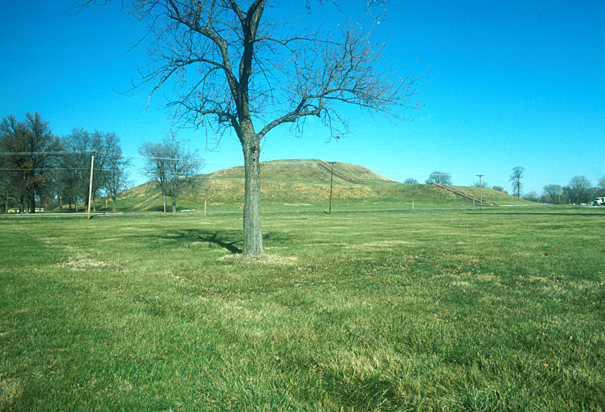

# Day 56 exit ticket

Lyle Kruger; date not supplied; public domain; photograph from federal byways collection.

Separate Location Record: The park-service account locates Cahokia's constructed earthworks in Illinois.

Source 56L; original summary of a separately authored record.

Name: __________________

Write a claim using both records and one limit.

________________________________________________________
