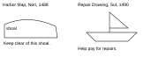

# Day 63 exit ticket

Name: ____________________

Made-up visual records. Mapmaker: Neri, 1488. Drawing maker: Sol, 1490.

Underline one inside clue suggesting purpose in each image.

________________________________________________________________

________________________________________________________________
