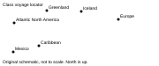

# Accumulating voyage map

Name: ____________________

Add only today's supplied route segment. This schematic shows relationships, not distances.

Route date: __________  Source label: __________

One aim: __________________________________________

One question still open: ______________________________

Source SAGA: Parks Canada, A Saga of Discovery, 2024. [Reference](https://www.parcs.canada.ca/lhn-nhs/nl/meadows/culture/saga). Original factual summary; no source image or modern wording reproduced.

Source LOC: Library of Congress, Columbus and the Taíno, undated. [Reference](https://www.loc.gov/exhibits/exploring-the-early-americas/columbus-and-the-taino). Original factual summary; no source image or modern wording reproduced.

Source CARTIER: Canadian Museum of History, Jacques Cartier 1534-1542, undated. [Reference](https://www.historymuseum.ca/virtual-museum-of-new-france/the-explorers/jacques-cartier-1534-1542/). Original factual summary; no source image or modern wording reproduced.

Source CORONADO: National Park Service, Coronado National Memorial, Stories, undated. [Reference](https://www.nps.gov/coro/learn/historyculture/stories.htm). Original factual summary; no source image or modern wording reproduced.
