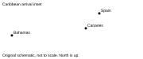

# Day 66 exit ticket

Name: ____________________

Captivity caption: Columbus reported ordering people taken to Spain. This was forced captivity. Taíno people were deprived of freedom.

Trace the arrival route on the Caribbean inset.

________________________________________________________________

________________________________________________________________

Explain one consequence for Taíno people in the captivity caption.

________________________________________________________________

________________________________________________________________

Source JOURNAL: Christopher Columbus; later abstract by Bartolomé de Las Casas, Journal excerpts, 1492; later recorder. [Reference](https://history.hanover.edu/courses/excerpts/111columbus.html). Original factual summary; no source image or modern wording reproduced.

Source LOC: Library of Congress, Columbus and the Taíno, undated. [Reference](https://www.loc.gov/exhibits/exploring-the-early-americas/columbus-and-the-taino). Original factual summary; no source image or modern wording reproduced.
