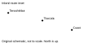

# Day 69 exit ticket

Name: ____________________

Siege caption: Spanish forces and Tlaxcalteca allies attacked Tenochtitlan in 1521. Mexica defenders resisted. Other Native groups also made different decisions.

Trace the inland route on the Tenochtitlan inset.

________________________________________________________________

________________________________________________________________

Explain who fought in the siege, using the caption.

________________________________________________________________

________________________________________________________________

Source MEXICO: Benson Latin American Collection, University of Texas Libraries, Invasion of Mexico, undated. [Reference](https://collections.lib.utexas.edu/exhibits/a-new-spain/invasion-of-mexico). Original factual summary; no source image or modern wording reproduced.
