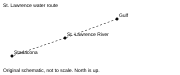

# Day 71 exit ticket

Name: ____________________

The museum identifies St. Lawrence Iroquoian communities in this homeland. It also records Cartier taking captives to France in 1536.

Trace the route from the Gulf toward Stadacona on the inset.

________________________________________________________________

________________________________________________________________

Name the historical communities whose homeland this route entered.

________________________________________________________________

________________________________________________________________

Source CARTIER: Canadian Museum of History, Jacques Cartier 1534-1542, undated. [Reference](https://www.historymuseum.ca/virtual-museum-of-new-france/the-explorers/jacques-cartier-1534-1542/). Original factual summary; no source image or modern wording reproduced.

Source HOMELAND: Canadian Museum of History; Raymonde Litalien, Founding Sites, undated. [Reference](https://www.historymuseum.ca/virtual-museum-of-new-france/colonies-and-empires/founding-sites/). Original factual summary; no source image or modern wording reproduced.
