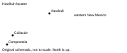

# Day 72 exit ticket

Name: ____________________

Aim caption: The expedition sought wealthy settlements.

Effect caption: An attack forced A:shiwi residents to leave Hawikuh.

Mark Hawikuh on the locator inset.

________________________________________________________________

________________________________________________________________

Contrast the expedition's aim with its effect on A:shiwi residents.

________________________________________________________________

________________________________________________________________

Source CORONADO: National Park Service, Coronado National Memorial, Stories, undated. [Reference](https://www.nps.gov/coro/learn/historyculture/stories.htm). Original factual summary; no source image or modern wording reproduced.

Source ASHIWI: Pueblo of Zuni Tribal Government, Official Tribal Website, 2026. [Reference](https://ashiwi.org/). Original factual summary; no source image or modern wording reproduced.
