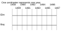

# Day 74 exit ticket

Name: ____________________

Made up for this task. Port Elm shipyard: 1460 to 1464. Port Bay warehouses: 1462 to 1465.

Draw both activity bars on the supplied grid.

________________________________________________________________

________________________________________________________________

Compare what happened during their overlapping years.

________________________________________________________________

________________________________________________________________
