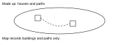

# Day 76 exit ticket

Name: ____________________

Made-up island records. The map labels houses and paths.

The arriving ruler's clerk declares that the island belongs to the ruler. No resident statement is included.

Write a claim about residents' consent supported by details from both records.

________________________________________________________________

________________________________________________________________
