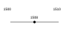

# Day 79 fresh attempt 3

Name: ____________________

Made-up diagram: 1508 is written over a marker halfway between 1500 and 1510.

Write the year actually shown by the marker.

______________________________________________________

______________________________________________________
