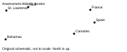
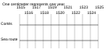

# Sources

Original summaries of real records, not quotations.

## A

L'Anse aux Meadows: bronze cloak pin in a dwelling's cooking pit. Later-recorded Norse sagas report regional encounters and conflict.

s04-CAMP/SAGA: paraphrase only.

## B

Waldseemüller, 1507: America labeled on western land, separate from Asia.

s04-MAP78: paraphrase only.

## C

Unknown illustrator, 1494: largely imaginary voyage woodcuts.

s04-LOC: paraphrase only.

## D

Columbus, October 13, 1492; Las Casas's later abstract: people exchanged cotton.

s04-JOURNAL: paraphrase only.

## E

Hernán Cortés, 1520: towns submitted to your authority; other towns taken by conquest.

s04-CORTES: paraphrase only.

## F

Columbus: Spain, Canaries, Bahamas, 1492. Cartier: France, Gulf, St. Lawrence.

Commission: seek gold and riches. Cartier took captives to France.

Tenochtitlan conquest: 1521. Cortés: 1519 to 1521, Mexico. Magellan-Elcano: 1519 to 1522, oceans.

s04-LOC/CARTIER/MEXICO/MAGELLAN: paraphrase only.

## G

Nahua institute: Carlos Cerecedo Cruz assists language-revitalization research today.

s04-G78: paraphrase only.
