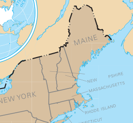
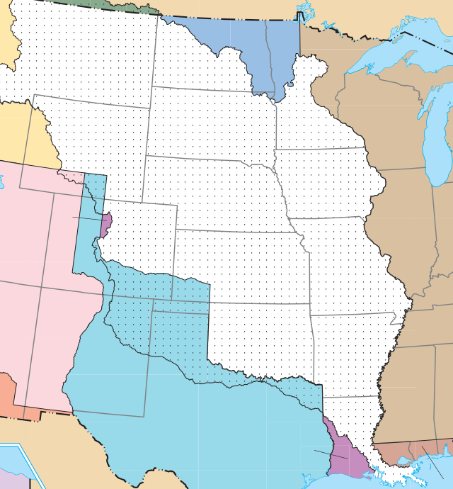

# Day 81 source card

Vermont became a state in 1791. North is up.

Separate Louisiana locator, national claim area:

Original source arrangement. Map shapes: United States Geological Survey, public domain.
