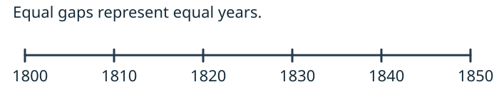

# Day 82 source card

Louisiana, 1803: France and United States negotiated.

Oregon boundary, 1846: Britain and United States negotiated.

Original source arrangement. Map shapes: United States Geological Survey, public domain.
