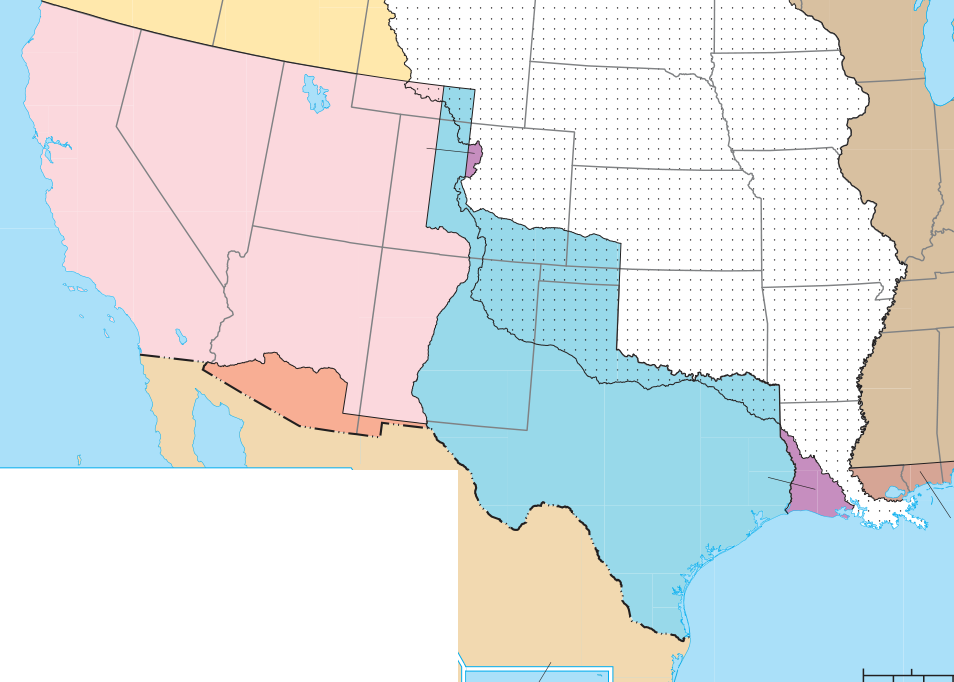

# Day 87 source card

Modern state outlines cross historical national-claim boundaries. Different fills mark different acquisitions. Trace the old claim lines before interpreting whole states.

Original source arrangement. Map shapes: United States Geological Survey, public domain.
