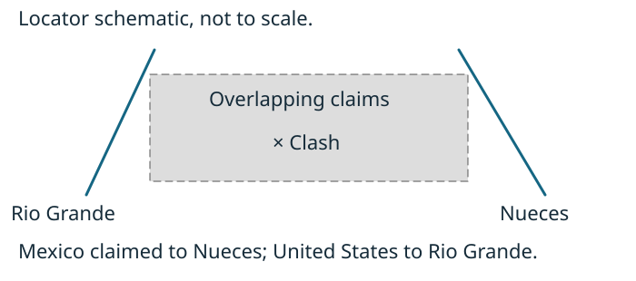

# Day 90 source card

Polk’s position: Mexico began the fighting. Later historian’s account: United States troops entered land both countries claimed.

Original source arrangement. Map shapes: United States Geological Survey, public domain.
