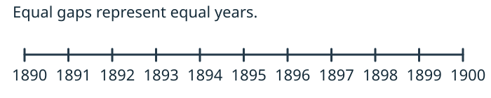

# Day 96 source card

Overthrow, 1893. Annexation, 1898.

Queen Liliuokalani’s December 19, 1898 letter protested United States ownership claims.

Original source arrangement. Map shapes: United States Geological Survey, public domain.
