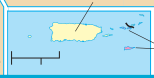

# Day 97 source card

War with Spain ended with treaty cession of Puerto Rico in 1898.

Current community card: the Instituto de Cultura Puertorriqueña lists music programs today.

Original source arrangement. Map shapes: United States Geological Survey, public domain.
