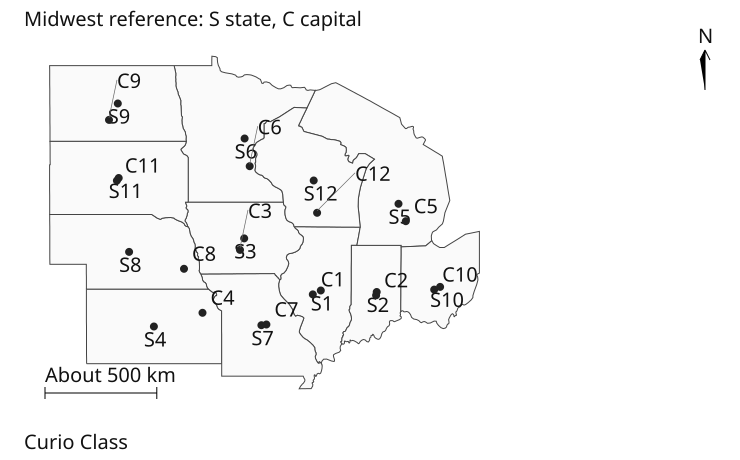

# Midwest reference strips

This is our classroom grouping. Other atlases may group states differently.

| S/C | State | Capital | Source locator |
|---|---|---|---|
| 1 | Illinois | Springfield | 39.8 N, 89.6 W |
| 2 | Indiana | Indianapolis | 39.8 N, 86.2 W |
| 3 | Iowa | Des Moines | 41.6 N, 93.6 W |
| 4 | Kansas | Topeka | 39.1 N, 95.7 W |
| 5 | Michigan | Lansing | 42.7 N, 84.5 W |
| 6 | Minnesota | Saint Paul | 44.9 N, 93.1 W |
| 7 | Missouri | Jefferson City | 38.6 N, 92.2 W |
| 8 | Nebraska | Lincoln | 40.8 N, 96.7 W |
| 9 | North Dakota | Bismarck | 46.8 N, 100.8 W |
| 10 | Ohio | Columbus | 40.0 N, 83.0 W |
| 11 | South Dakota | Pierre | 44.4 N, 100.4 W |
| 12 | Wisconsin | Madison | 43.1 N, 89.4 W |

Use one entry at a time. The capital symbol follows the source classification.

