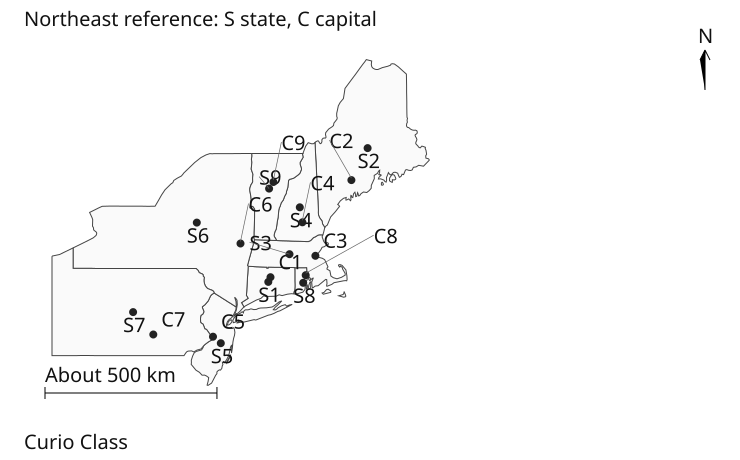

# Northeast reference strips

This is our classroom grouping. Other atlases may group states differently.

| S/C | State | Capital | Source locator |
|---|---|---|---|
| 1 | Connecticut | Hartford | 41.8 N, 72.7 W |
| 2 | Maine | Augusta | 44.3 N, 69.8 W |
| 3 | Massachusetts | Boston | 42.3 N, 71.1 W |
| 4 | New Hampshire | Concord | 43.2 N, 71.5 W |
| 5 | New Jersey | Trenton | 40.2 N, 74.7 W |
| 6 | New York | Albany | 42.7 N, 73.8 W |
| 7 | Pennsylvania | Harrisburg | 40.3 N, 76.9 W |
| 8 | Rhode Island | Providence | 41.8 N, 71.4 W |
| 9 | Vermont | Montpelier | 44.3 N, 72.6 W |

Use one entry at a time. The capital symbol follows the source classification.

