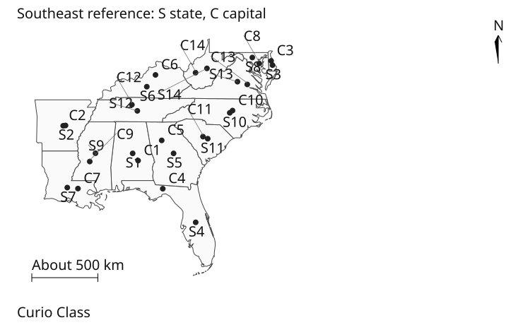

# Southeast reference strips

This is our classroom grouping. Other atlases may group states differently.

| S/C | State | Capital | Source locator |
|---|---|---|---|
| 1 | Alabama | Montgomery | 32.4 N, 86.3 W |
| 2 | Arkansas | Little Rock | 34.7 N, 92.3 W |
| 3 | Delaware | Dover | 39.2 N, 75.5 W |
| 4 | Florida | Tallahassee | 30.4 N, 84.3 W |
| 5 | Georgia | Atlanta | 33.7 N, 84.4 W |
| 6 | Kentucky | Frankfort | 38.2 N, 84.9 W |
| 7 | Louisiana | Baton Rouge | 30.5 N, 91.1 W |
| 8 | Maryland | Annapolis | 39.0 N, 76.5 W |
| 9 | Mississippi | Jackson | 32.3 N, 90.2 W |
| 10 | North Carolina | Raleigh | 35.8 N, 78.6 W |
| 11 | South Carolina | Columbia | 34.0 N, 81.0 W |
| 12 | Tennessee | Nashville | 36.2 N, 86.8 W |
| 13 | Virginia | Richmond | 37.6 N, 77.5 W |
| 14 | West Virginia | Charleston | 38.3 N, 81.6 W |

Use one entry at a time. The capital symbol follows the source classification.

