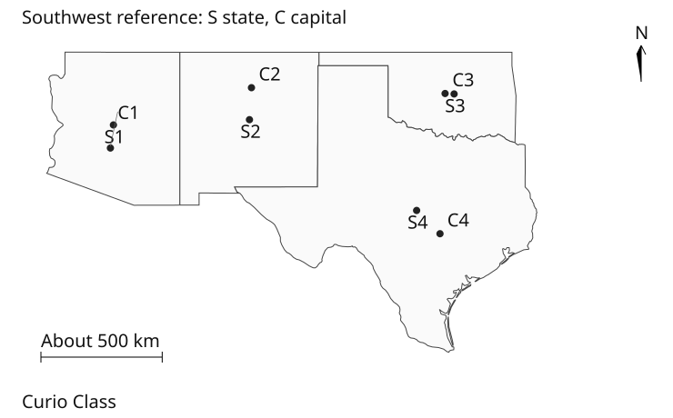

# Southwest reference strips

This is our classroom grouping. Other atlases may group states differently.

| S/C | State | Capital | Source locator |
|---|---|---|---|
| 1 | Arizona | Phoenix | 33.4 N, 112.1 W |
| 2 | New Mexico | Santa Fe | 35.7 N, 105.9 W |
| 3 | Oklahoma | Oklahoma City | 35.5 N, 97.5 W |
| 4 | Texas | Austin | 30.3 N, 97.7 W |

Use one entry at a time. The capital symbol follows the source classification.

