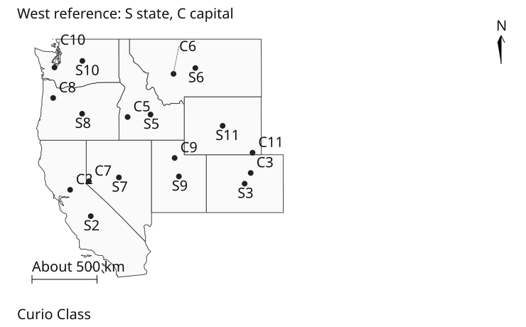
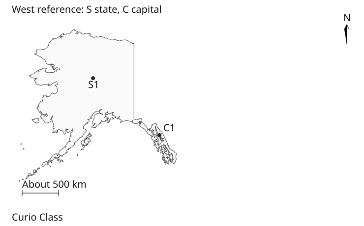
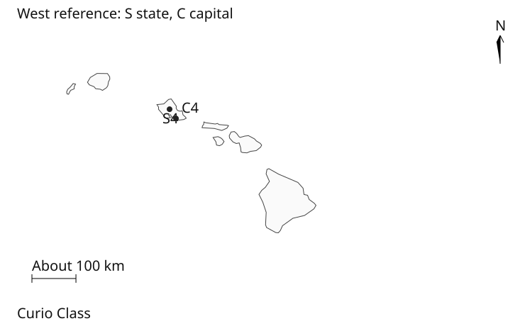

# West reference strips

This is our classroom grouping. Other atlases may group states differently.

| S/C | State | Capital | Source locator |
|---|---|---|---|
| 1 | Alaska | Juneau | 58.3 N, 134.4 W |
| 2 | California | Sacramento | 38.6 N, 121.5 W |
| 3 | Colorado | Denver | 39.7 N, 105.0 W |
| 4 | Hawaii | Honolulu | 21.3 N, 157.9 W |
| 5 | Idaho | Boise | 43.6 N, 116.2 W |
| 6 | Montana | Helena | 46.6 N, 112.0 W |
| 7 | Nevada | Carson City | 39.2 N, 119.8 W |
| 8 | Oregon | Salem | 44.9 N, 123.0 W |
| 9 | Utah | Salt Lake City | 40.8 N, 111.9 W |
| 10 | Washington | Olympia | 47.0 N, 122.9 W |
| 11 | Wyoming | Cheyenne | 41.1 N, 104.8 W |

Use one entry at a time. The capital symbol follows the source classification.

