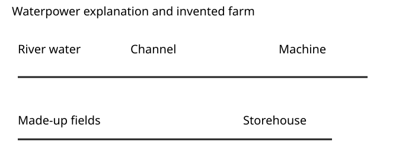

# Day 107 teaching cards

## Hook A: Paterson

People directed river water through built channels at Paterson. The water powered mill machinery.

## Hook B: made-up farm

A farmer plants fields beside a storehouse. This diagram establishes no fact about real soil.

## Question cards

Where are the states and territories?
What changes with statehood?
What must our maps show?
How do resources, choices and trade shape work?
What makes the national capital different?

Sort under location, statehood, maps, work and capital.

