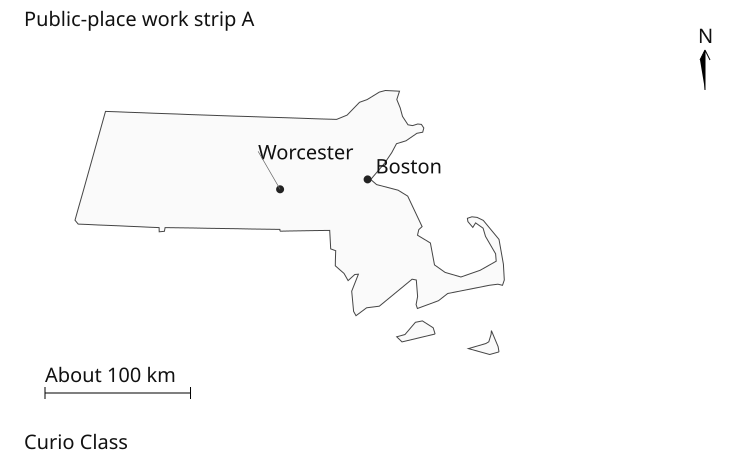

# Day 113 teaching cards

## Work Strip A

Study public places in Massachusetts. Boston is the capital. Worcester is an inland city.
Use the fresh political outline. Record the maker, URL and public-place positions.

Do not ask where anyone lives. Anyone may use this supplied public-state case.
The teacher keeps Record B covered until the exit.

