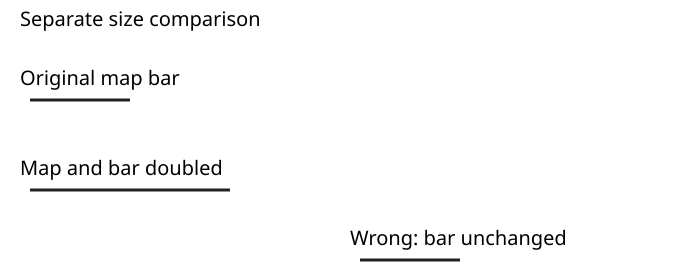
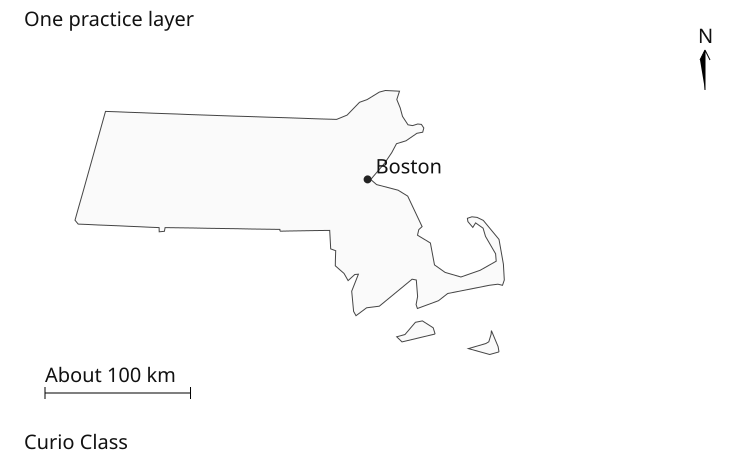

# Day 114 teaching cards

## Separate convention proofs

A title names what the map shows. A key explains its symbols.
A compass rose shows directions. A scale links map distance and actual distance.
Resize a map and its bar together. These rulers illustrate size, not geography.

## Practice layers

Use Massachusetts's boundary and Boston point on separate sheets.
Do not assemble a complete city/water/mountain response in practice.

