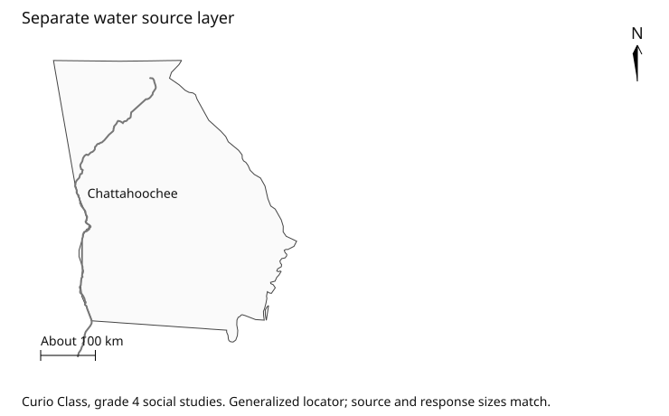

# Day 115 teaching cards

## Georgia practice layers

The Chattahoochee River source line is a water layer.
A separate outline carries the state boundary. Add only the requested source annotation.

Keep key checks separate. Do not add Augusta, Savannah River or Blue Ridge before the exit.

