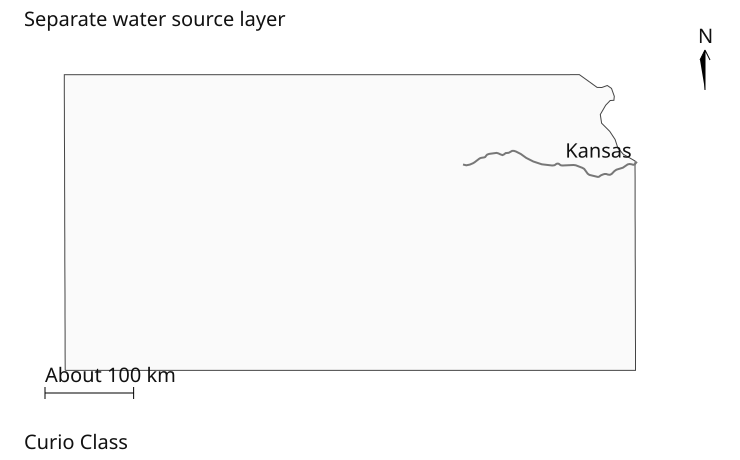
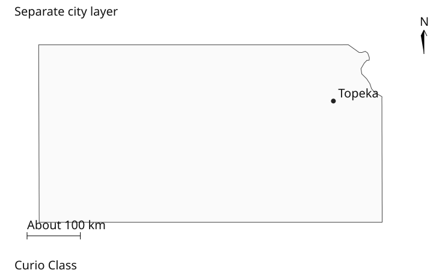

# Day 116 teaching cards

## Kansas practice layers

Water is natural. A city is built. Growing crops and processing food are human activities.
These sources locate Topeka and the Kansas River separately. They do not survey farms.

