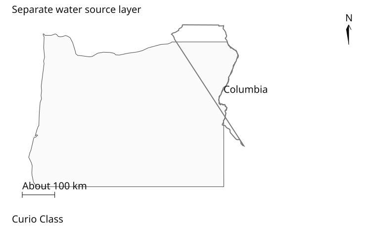
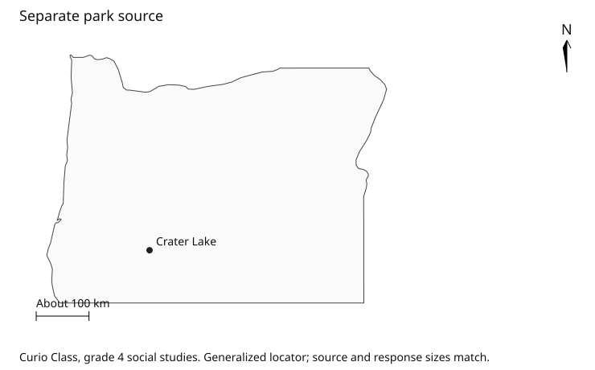
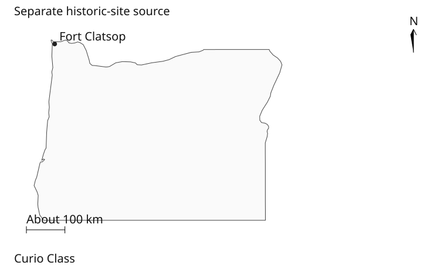

# Day 118 teaching cards

## Separate Oregon layers

The Columbia is a river. Crater Lake National Park is a park.
Fort Clatsop is a historic site. An original coast-rock sketch illustrates a landmark category.
The coast-rock sketch is made up. It does not identify a real rock.

Annotate each category separately. No complete four-category inset is practiced.

