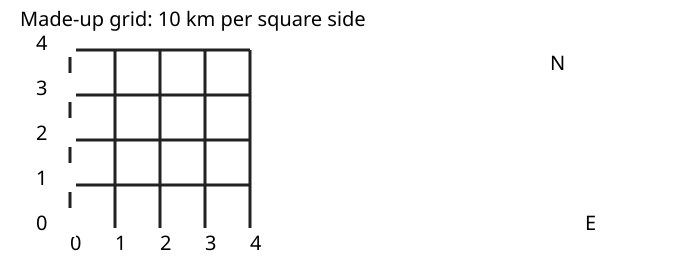

# Day 116 held source record

This diagram is made up. North is up. Each square side represents ten kilometers.

Start at the lower-left corner. Count east first, then north.

River: western edge.
Soil: square from (1,1) to (3,3).
Wheat: (2,2).
Flour mill: (0,1).

