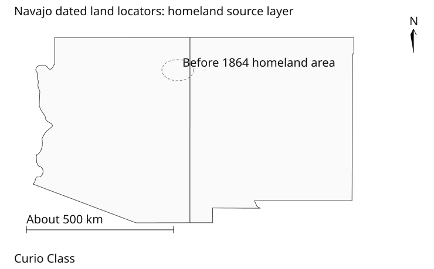
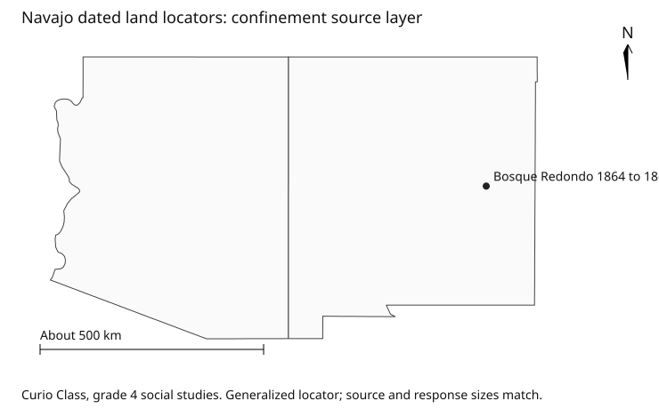
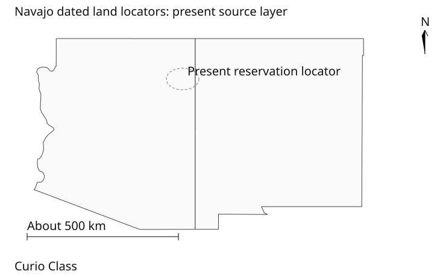
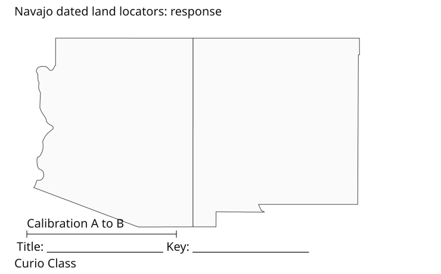

# Day 117 held source record

These are generalized land locators, not legal boundaries.

Before 1864 homeland, 1864 to 1868 confinement and present reservation describe different land relationships.
The army forced Navajo people to Bosque Redondo.

Use a dashed arrow for forced movement. Place its arrowhead toward the confinement site.

