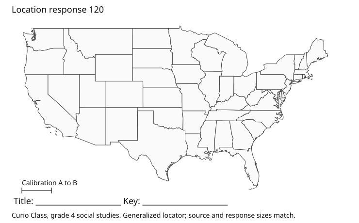
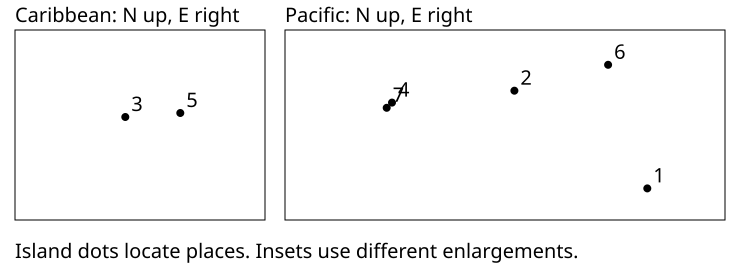

# M1 new geographic record

Use the atlas reference index during the location task.

New Hampshire | Virginia | Missouri | Texas | Idaho

D.C.; Puerto Rico; United States Virgin Islands.

Pacific names: American Samoa; Guam; Northern Mariana Islands; Midway Islands; Wake Island.
