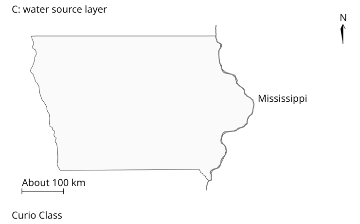
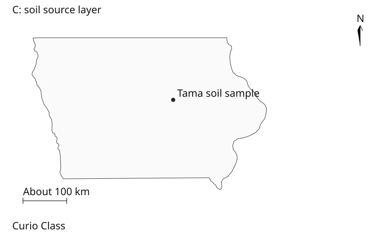
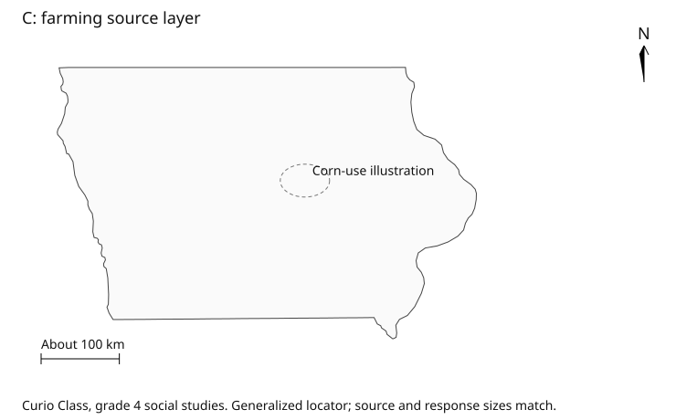
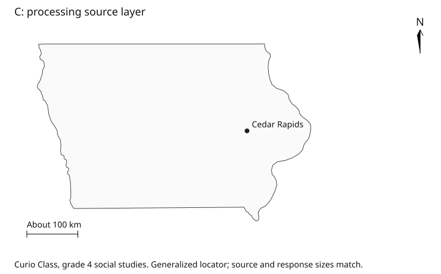
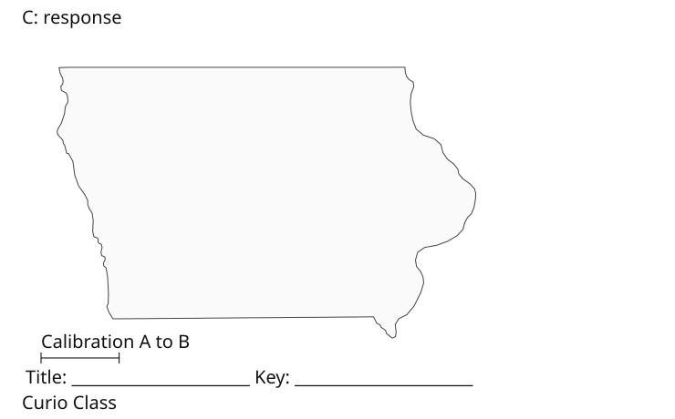

# atlas-C source sleeve

Use the source layers to make one new map. Include title, north, key and matching scale.

Soil dot: documented sample. Corn-use area: illustrative, not a surveyed farm or soil zone.

Teacher criterion cue: __________________

Revision date: __________________
