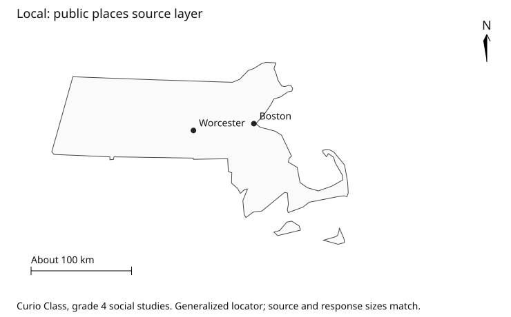
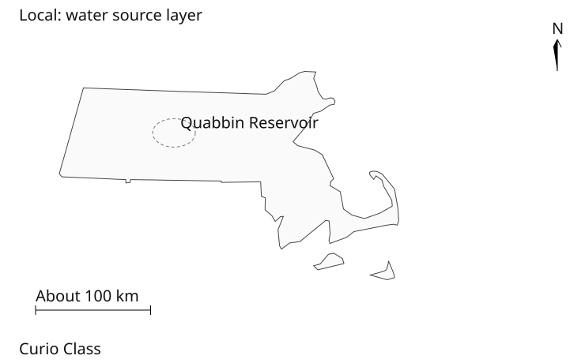
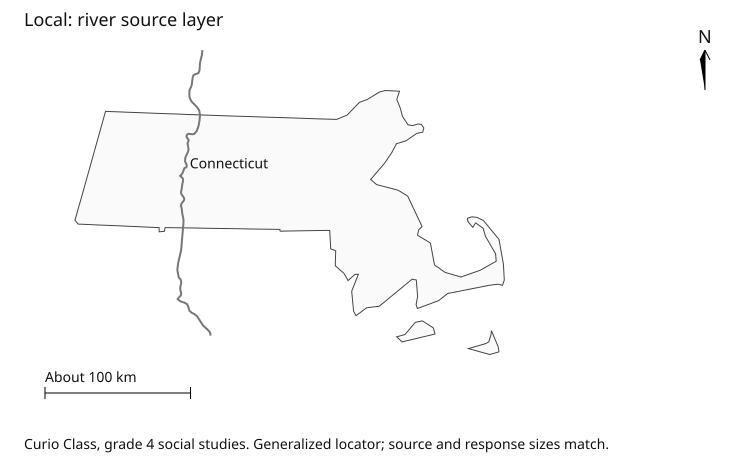
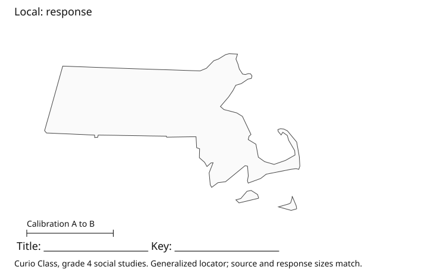

# atlas-Local source sleeve

Use the source layers to make one new map. Include title, north, key and matching scale.

Teacher criterion cue: __________________

Revision date: __________________
