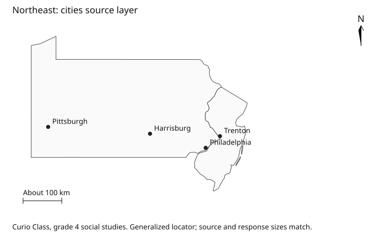
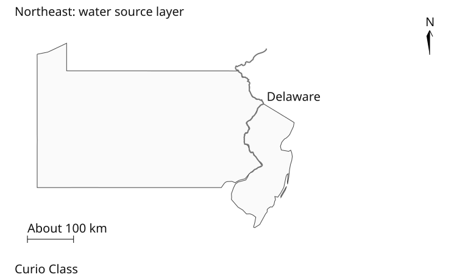
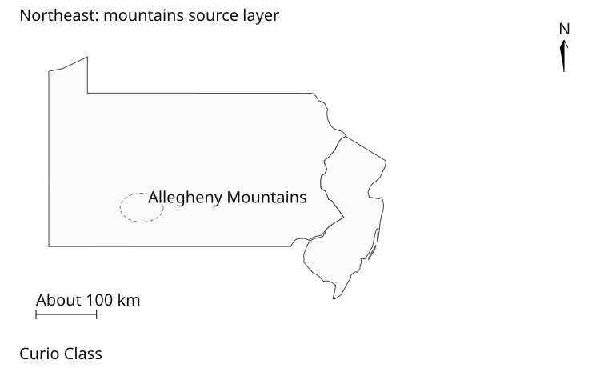
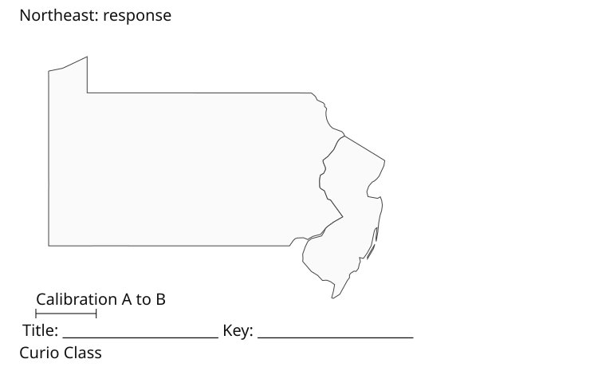
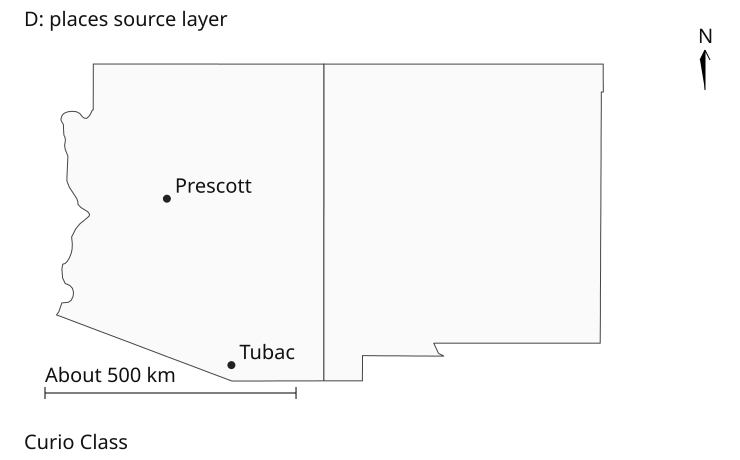
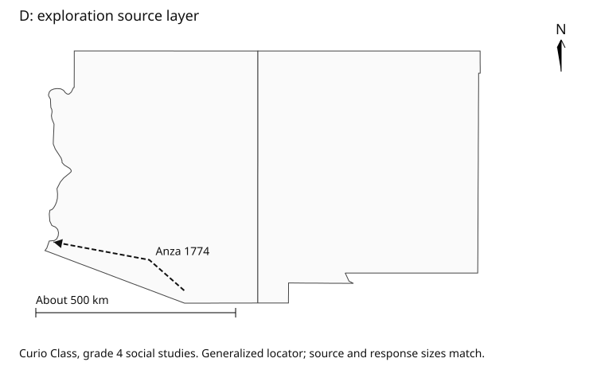
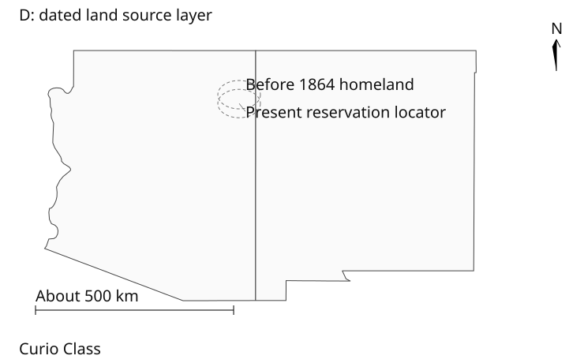
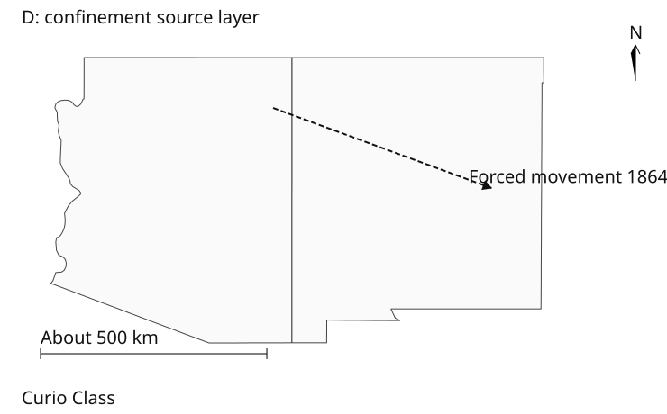
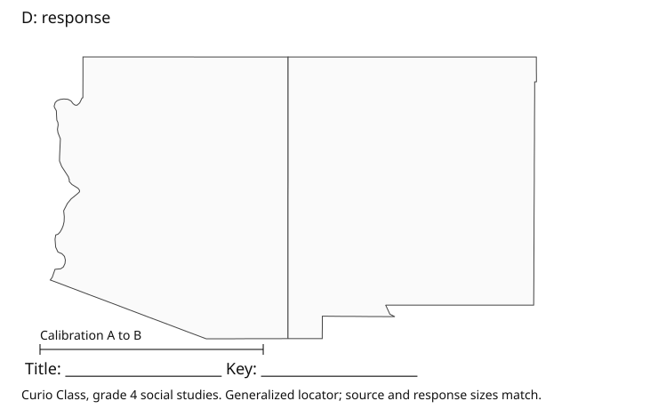

# Day 120 teacher source book

Teacher source book. Read the factual captions neutrally. Keep completed teaching work covered.

Use the matching blank response masters. Source layers give locations, not a completed thematic answer.
Locators are generalized; dotted halos are not legal boundaries. Arrows connect places, not precise travel paths.

## atlas-A

## atlas-D

## D captions

Anza left Tubac to explore a route in 1774. Tubac and Prescott are settlement sites.
Navajo homeland, forced confinement and present land locators have different dates and meanings.
The confinement arrow continues into New Mexico. Bosque Redondo is not inside Arizona.
