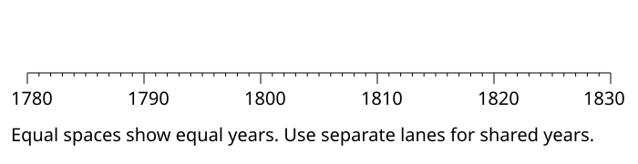

# Fresh Northeast record cards

Original thirteen dates record constitutional ratification. Maine and Vermont dates record admission.

Connecticut: January 9, 1788

Maine: March 15, 1820

Massachusetts: February 6, 1788

New Hampshire: June 21, 1788

New Jersey: December 18, 1787

New York: July 26, 1788

Pennsylvania: December 12, 1787

Rhode Island: May 29, 1790

Vermont: March 4, 1791

