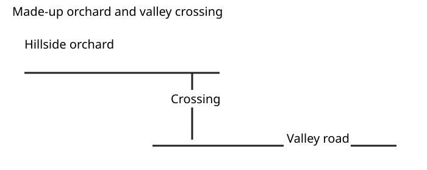

# Day 121 teaching cards

## Paterson: resource and human action

Water from the Passaic River supplied power. People built channels to carry it to machinery.
Factories clustered near the waterpower system. More streets and buildings accompanied industrial growth.
Natural conditions offered possibilities. People made choices and built systems.

## Made-up orchard model

A hillside orchard has a crossing to the valley road. The crossing carries fruit to carts.
This explains a possible adaptation. It is not evidence about an actual town.

