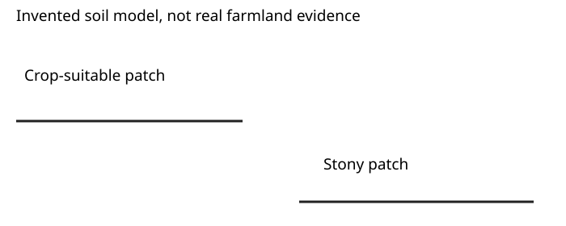

# Day 122 teaching cards

## P: Paterson account

Built channels carried Passaic River water to mill machinery. Industry clustered along the channels.
Street and building growth accompanied that industry. This account does not show every worker's choice.

## H: Salem account

Wharves extended into Salem's harbor. Ships used the waterfront to load and unload goods.
It illustrates adaptation and trade at a different place. It does not verify a Paterson event.

## Made-up soil model

One patch has soil suitable for crops. Another patch is stony. People choose possible uses.
This diagram is invented. It establishes no real farming zone.

