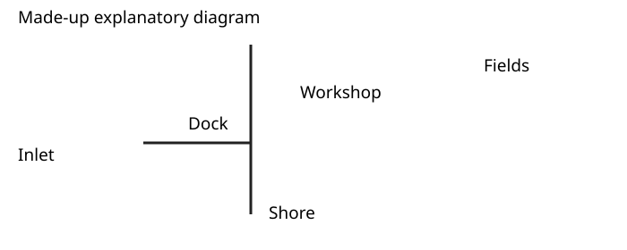

# Day 122 held source record

Both records and their makers are made up.

A, harbor surveyor: an inlet reaches the shore. A built dock enters it.
Workshop: beside the dock. Fields: inland.

B, grower: We grow beans in these fields. We send beans through the dock to buyers.

