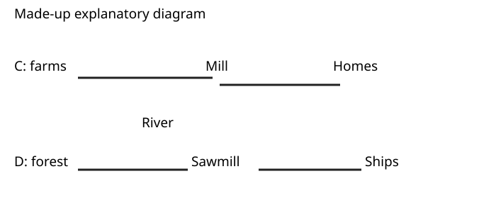

# Day 123 held source record

These are made-up regional models. They are not regional statistics.

C, Midwest: Grain farms send oats to a mill beside a river. Homes stand near the mill.

D, West: A forest supplies logs to a coastal sawmill. Ships carry boards away.

