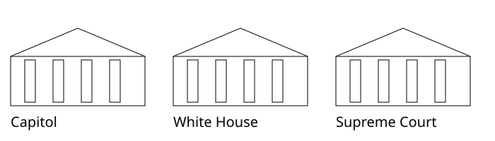

# Day 126 teaching cards

## Branch jobs

Legislative: makes national laws. Congress meets at the Capitol.
Executive: carries out national laws. The president works at the White House.
Judicial: decides legal cases. Justices work at the Supreme Court.

A governor leads a state. A mayor leads a local government.
A constitution sets up and limits government.

The teacher draws one relationship at a time. Cover all completed arrows before checking.
