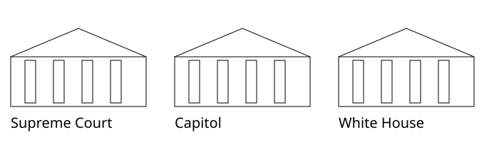

# Day 126: National work and buildings

## Teacher page
### Before class
Prepare student pages and s06-X126b half slips. Use exit-126-stimulus and exit-126 as adult assembly guides. Keep the Exit box covered. Keep cards-126, practice-126 and key-teacher adult-only; key-teacher holds the current answers and samples. Have opener, record, source-index and day 125 papers. Choose six roster names for listening. The teaching-buildings and exit-126-buildings drawings are symbolic labeled outlines, not architectural portraits.

### The day
#### 5 min. Return and repair

Return day 125's written tasks: s06-X125a. Use the existing private cue and repair time.

Return day 125 tickets and s06-P125-1, s06-P125-2, s06-P125-3. If many day 125 tickets showed error V, review sales meeting other needs with [[s06-W126-1]]. This shoemaker account is made up. Children add one arrow. Remind individual choice misses that saving remains available, reviewing day 125. Collect retries; give others the same independent arrow task.

#### 5 min. Retrieve levels
Review grade 3 day 28: mayor/local, governor/state, president/national. Alone, use [[s06-P126-1]]. Review constitution from grade 3 day 41: a basic plan setting up and limiting government. Use [[s06-R126-1]]. Record gaps for tomorrow; no public queue. Source s06-d126-levels supports levels; Source s06-d126-government supports the constitution reminder.

#### 10 min. Teach buildings
Review capital and capital district from days 108 and 109: Washington, D.C. is the national capital, not a state. Review branch from grade 3 day 28: one government part with its own job. Introduce legislative, executive and judicial labels through cards-126. Review the White House home/office link from grade 1 day 62. Describe buildings separately: Congress/Capitol, president/White House, justices/Supreme Court. Buildings house people; branches describe government work.

**Ask.** [[s06-K126-1]] Take ideas before revealing [[steps:s06-K126-1]]. Sources s06-branches, s06-capitol, s06-white-house and s06-court support these connections; use source-index. Keep completed relationships private, without practicing a three-building matching table.

#### 15 min. Practice and explain
Use practice-126 as an adult layout reference; the student page holds the revised action task. With building summaries covered, children sort the action phrases in [[s06-P126-2]] on paper. Fifteen pairs each take two one-minute turns simultaneously. Hear the six roster children for 45 seconds each during remaining work: 4.5 minutes. Passing publicly is allowed. Meet retrieval gaps within five work minutes; collect every page.

#### 5 min. Exit ticket
Cover all teaching. Reveal the new labeled view and [[s06-X126a]] only at each child's own turn, in the Exit box. Children complete its table and [[s06-X126b]] alone on the half slip. Read neutrally or scribe exact words. Both are paper responses. Collect pages and slips.

### Other rooms
No printer: copy the supplied outlines and response spaces, covering the exit separately. No live page is needed.

### At home
**Swap.** No printer: copy the questions, outlines and table, covering the exit.
**Skip.** Class roster and public sharing.
- **5 min. Repair.** Return yesterday's paper; use [[s06-W126-1]].
- **5 min. Retrieve.** Use [[s06-P126-1]] and [[s06-R126-1]].
- **10 min. Teach.** Read cards-126. Point to each labeled teaching building separately. Use [[s06-K126-1]].
  **Say.** "What happens after a national law is made?" Expect: the executive branch carries it out.
- **15 min. Practice.** Cover building summaries. Your child sorts the actions in [[s06-P126-2]]. Take a partner turn explaining one choice.
  **Say.** "Which branch job fits deciding a case?" Expect: judicial.
- **5 min. Exit ticket.** Reveal the held view. Your child completes [[s06-X126a]] in its table and [[s06-X126b]] on paper alone. Keep both for tomorrow.

### Shorter or longer
Shorter: reduce partner repeats, retaining all tasks and exit. Longer: explain why a branch is different from its building.

### Words and supports
Review branch, constitution and government levels. New labels: legislative, executive, judicial. Enlarge print; neutral dictation preserves decisions.

### Tomorrow
Mark thirty complete sets at 60 seconds each, thirty minutes after class. Record shown, shown with help, not yet seen by component. Day 127 returns every paper in Return and repair. If many day 126 tickets show error I, repair office levels and branch jobs together using a fresh diagram. Then explore museums, archives, monuments and the district's voting limit.

### Credit
Ours. The shoemaker account is made up. Official factual sources are listed in source-index and sources.csv.

## Student page
### Side 1
**I can connect national workers, buildings and branch jobs.**

**Review: work and purchases. This account is made up.**
A shoemaker sells shoes. A fruit stall sells fruit. The shoemaker needs fruit.
[[s06-W126-1]]
________________________

**Review: government levels.**
[[s06-P126-1]]
Local: __________ State: __________ National: __________

**Review: constitution.**
[[s06-R126-1]]
________________________

**Think before the model.**
[[s06-K126-1]]
________________________

**Action phrases**
Writing a law. Putting a law into action. Deciding a court case.
[[s06-P126-2]]
Legislative: ________________________
Executive: ________________________
Judicial: ________________________

### Side 2
**Exit box. Keep covered until your own turn.**

Loose label: state governor.
[[s06-X126a]]

| Building | National worker | Branch |
|---|---|---|
| Supreme Court | __________ | __________ |
| Capitol | __________ | __________ |
| White House | __________ | __________ |
