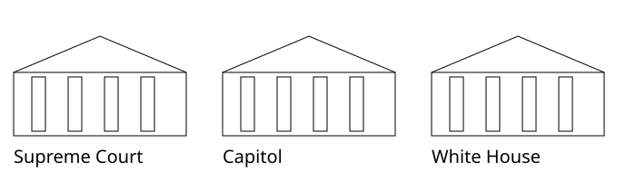

# Day 126 held source record

New named building views. They show identities, not office matches.

Loose label: state governor.

| Building | National worker | Branch |
|---|---|---|
| Supreme Court | ______ | ______ |
| Capitol | ______ | ______ |
| White House | ______ | ______ |
