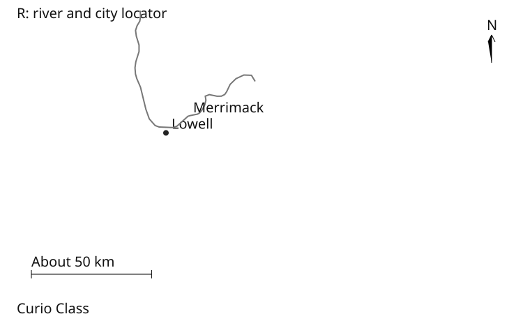

# Reserved sources R and S

## R: geographic locator

Maker: public geographic data contributors. Purpose: locate rivers and cities.
Lowell lies beside the Merrimack River in Massachusetts.

## S: historical account

Maker: National Park Service. Purpose: explain Lowell's industrial history.
Workers built canals to power textile machines. Mills and paid work helped the city grow.
Raw cotton arrived for cloth production. Cloth moved to buyers.
Enslaved people were forced to produce cotton. People also resisted slavery and sought freedom.

The accounts establish neither every job nor a real soil zone. They show no exact shipping route.
