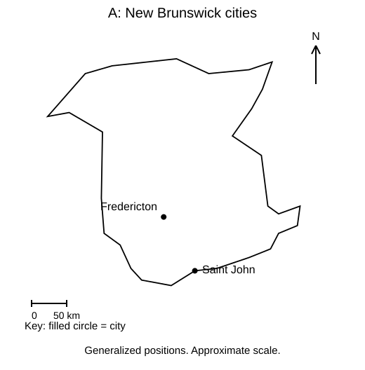
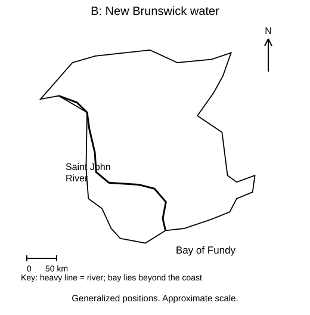

# New Brunswick reference atlas

## Page A: cities

## Page B: water

These maps are simplified. Positions and scale are approximate.
Source: New Brunswick transportation department map, 2020.

## Card C: shipbuilding
Parks Canada describes shipbuilding in New Brunswick during the 1800s.
Timber and skilled builders helped centers such as Saint John build ships.
Many ships were built for export.

## Card D: a growing city
Saint John's city history links its industrial growth to shipbuilding during the 1800s.
The harbor also welcomed newcomers.
These records do not explain every person's job or reason for settling.
