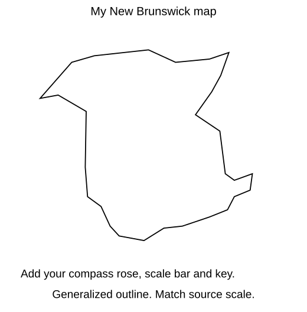

# Day 133: Map a province and explain its work

## Teacher page
### Before class
Read teacher-only key-checks-133-136 and prepare record-checks-133-136. Keep the new atlas unseen. Copy city/water layers and response outline at equal size; compare their borders. Check the printed 50-kilometer bars measure equally. Keep the approximate scale with its map. Cover earlier examples. No live page or photograph is needed.

### The day
#### 3 min. Orient
Day 132 responded to the unit assessment. Retain its unresolved component and access notes. Explain independent work without rehearsing geography. Say today's province maps are generalized. Hand out A, B, C and D. Distinguish source authors from our summaries.

#### 24 min. Map construction
Children independently complete [[C3-E133-M]] on map-133-response, using the separate atlas layers. The student checklist names required features and conventions. No completed combined map is shown. Read labels neutrally, enlarge the entire source/response pair together, or scribe exactly with the child directing placements. Record content help separately. Do not choose positions or interpret the key.

#### 10 min. Resource explanation
Children independently complete [[C3-E133-G]] from cards C and D. Accept sentences, a labeled connection drawing or dictation. Judge resource, human action, city growth and trade links separately. Do not turn a source list into an answer for the child.

#### 3 min. Collect
Collect everyone's maps and explanations. No thirty-child oral queue is planned. Mark after class using the descriptive component scale. Missing positions suggest error Y, mismatched calibration error M, and universal or missing resource mechanisms error Z. Return a private cue on day 135; tomorrow remains cold.

### Other rooms
No printer: trace the same generalized border three times before class and copy the two reference layers. Match map and scale proportions. No screen, visitor or photograph is needed.

### At home
**Swap.** Trace matching source layers and response outline if printing is unavailable. Use a folder for the record.
**Skip.** Class collection and public talk.
- **27 min. Assessment map.** Keep the answer key away. Give the atlas and [[C3-E133-M]]. Your child directs every placement. Read words neutrally if needed.
- **10 min. Explain.** Your child answers [[C3-E133-G]] using cards C and D.
  **Say.** "Explain how resources helped Saint John grow as a shipbuilding center." Expect: timber, skilled shipbuilding, exports and city growth connected through both cards. Keep this expectation private until your child finishes.
- **3 min. Save.** Collect both pieces. Read the teacher key privately afterward. Save one next-step note for day 135. Keep tomorrow's sources unseen.

### Shorter or longer
Keep both tasks. Record unfinished components as unobserved. Longer: children check their map against the same references, without new hints.

### Words and supports
Review scale, key, compass rose, natural resource and evidence from written days 114, 116 and 122. A resource is something from nature people use. Access support changes presentation, not geographic decisions.

### Tomorrow
Day 134 uses new history accounts and a two-source claim. Hand back this map in day 135 Feedback; M, Y and Z needs join the single-priority response record.

### Credit
Ours. Factual references: Sources C3-133-atlas, C3-133-ships and C3-133-city. Maps are generalized drawings; text is our factual summary.

## Student page
### Side 1
**I can map a province using source evidence.**
Use atlas pages A and B and the separate response outline.
[[C3-E133-M]]

Map parts:
- Title identifying the province.
- Cities: Fredericton and Saint John.
- Physical features: Saint John River and Bay of Fundy.
- A compass rose, matching scale bar and key.

Use the outline below. Keep the approximate scale label with your bar.

### Side 2
**I can explain a resource connection.**
Use cards C and D.
[[C3-E133-G]]
{sketch}
________________________________________________
________________________________________________
________________________________________________
