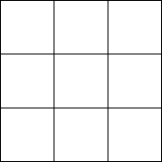

# Day 136: Confirm with fresh evidence

## Teacher page
### Before class
Read day 135 tickets and key-checks-133-136. Choose two common needs for repair meetings. Give every child one written move and a matched fresh ticket. Prepare record-checks-133-136 and separate cards-checks-136 sections. For S1 include the signed dock notice and archive index. For M, provide a blank 6-centimeter square divided into nine equal squares; the child places features and conventions.

### The day
#### 5 min. Feedback
Return day 135's exit ticket and written task retry. Children privately identify one next move. If many still missed M/Y, Z, P/Q/R or W, prioritize the two largest needs. Never turn one improved response into a claim about every component.

#### 10 min. Targeted repair
Two sequential five-minute meetings use the appropriate separate example: [[C3-K136-M]], [[C3-K136-G]], [[C3-K136-S]], [[C3-K136-S1]] or [[C3-K136-C]]. Others independently use the same printed teaching card and written cue. For S origins, use the garden record and its two-date archive label. For audience or purpose, use the garden addressee and path-clear request. Show the matching answer only after an attempt. Teach missing meanings as new; never cite planned-only entries as learned.

Each meeting hears two 45-second replies at most, leaving three-and-a-half minutes for modeling and handling. Record four names at most. All submit the short teaching response. Public passing is allowed; nobody reports personal family, money or migration information.

#### 15 min. Independent confirmation
Cover teaching. Reveal each child's one held card and Side 2 written task: [[C3-X136-M]], [[C3-X136-G]], [[C3-X136-S]], [[C3-X136-S1]], [[C3-X136-S2]] or [[C3-X136-C]]. Use the Side 2 Retry box; M uses its blank grid. M constructs a map on the blank grid; its source is verbal directions, not a completed map. Match S to the precise need: original maker/date, audience or purpose. Unassigned components stay open. Read neutrally or scribe exactly without content hints. Begin checking written task retries during the last six minutes.

#### 10 min. Exit ticket and reflect
Give everyone [[C3-X136-R1]], a new made-up inspection/missing-page case. Children answer alone for three minutes. During the remaining seven minutes, return checked written task retries and common exits with one private evidence cue. Children locate an improvement; no extra judged prompt follows. Allow twenty seconds per retry plus five seconds per common ticket: twelve-and-a-half minutes for thirty across this block and the last six independent minutes, an untested estimate. Maps may take longer. Finish remaining marking after class. Return any still-held C3-X136-R1 tickets with a written cue in day 137's first Hook minute. Papers already returned today stay in children's folders; no new repair is added. Never record an unmarked paper as accomplished.

### Other rooms
Copy only assigned teaching and held cards if printing is unavailable. Ruler and scrap paper replace printed grids. No live source, visitor or photograph is needed.

### At home
**Swap.** Copy assigned cards and use scrap paper if printing is unavailable. For M, draw the blank grid with a ruler.
**Skip.** Class meetings and roster turns.
- **5 min. Feedback.** Return yesterday's written retry and common ticket. Name one next step.
- **10 min. Repair.** Use the matching card and [[C3-K136-M]], [[C3-K136-G]], [[C3-K136-S]], [[C3-K136-S1]] or [[C3-K136-C]]. Give feedback after an attempt.
  **Say.** "Which printed detail changes your answer?" Expect a relevant feature or evidence clue.
- **15 min. Fresh retry.** Cover teaching. Your child answers the assigned Side 2 task: [[C3-X136-M]], [[C3-X136-G]], [[C3-X136-S]], [[C3-X136-S1]], [[C3-X136-S2]] or [[C3-X136-C]]. Use its held card.
- **10 min. Exit ticket.** Your child answers [[C3-X136-R1]] alone. Read the teacher key privately afterward. Return a helpful cue and save unresolved questions.

### Shorter or longer
Trim repeated oral replies; preserve independent confirmation. Longer: examine existing evidence without future sources or new judged tasks.

### Words and supports
Review key, scale, resource, source and claim in their written meanings. Purpose is what a maker wanted a source to do. Separate access needs from content help.

### Tomorrow
Day 137 opens the question about regional peoples and land, then supporting questions. Day 137's first Hook minute returns any C3-X136-R1 tickets whose marking finishes after class. Pass unresolved components and access notes into the teacher record. Do not assume an extra repair slot or completed mastery of unobserved components.

### Credit
Ours. Source C3-136-own documents invented places, records and measurements.

## Student page
### Side 1
**I can check an improvement with fresh evidence.**
Today's response cases are made up.
Use only your assigned teaching card and task.

**M: Map key**
[[C3-K136-M]]
________________________
**G: Resources**
[[C3-K136-G]]
________________________
**S: Source clues. Complete only your assigned focus.**
[[C3-K136-S]]
[[C3-K136-S1]]
________________________
**C: Claims**
[[C3-K136-C]]
________________________

### Side 2
**My next move**
_____________________________________________
Complete one assigned fresh retry below. Use the Retry box.

**M** [[C3-X136-M]]
**G** [[C3-X136-G]]
**S** [[C3-X136-S]]
**S1** [[C3-X136-S1]]
**S2** [[C3-X136-S2]]
**C** [[C3-X136-C]]

**Retry box**

{small}
