# Day 131 teacher source book

Teacher source book. Read the factual captions neutrally. Keep completed teaching work covered.

Use the matching blank response masters. Source layers give locations, not a completed thematic answer.
Locators are generalized; dotted halos are not legal boundaries. Arrows connect places, not precise travel paths.

## atlas-F

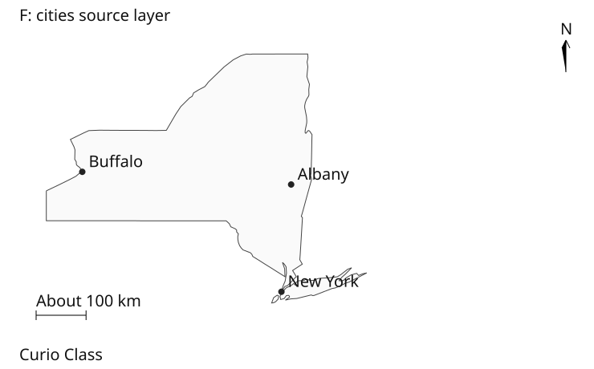

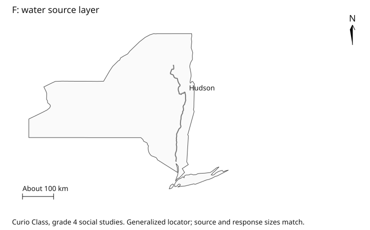

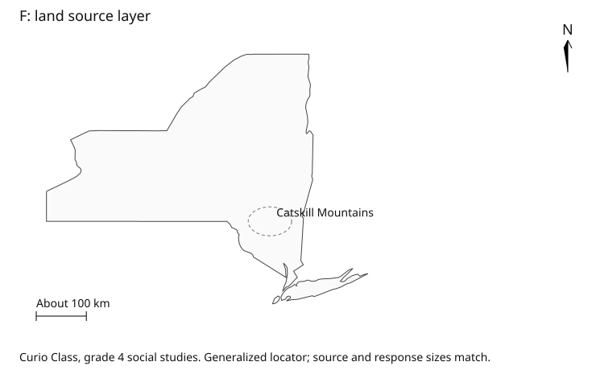

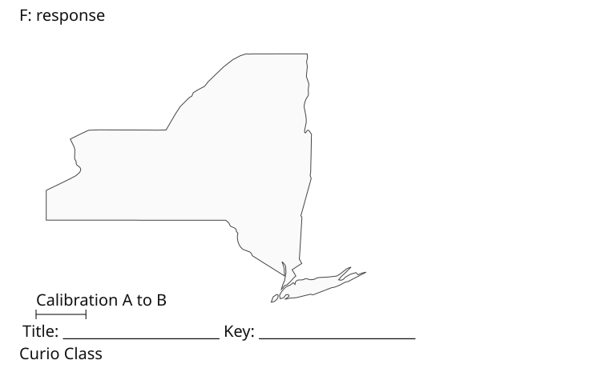

## atlas-G

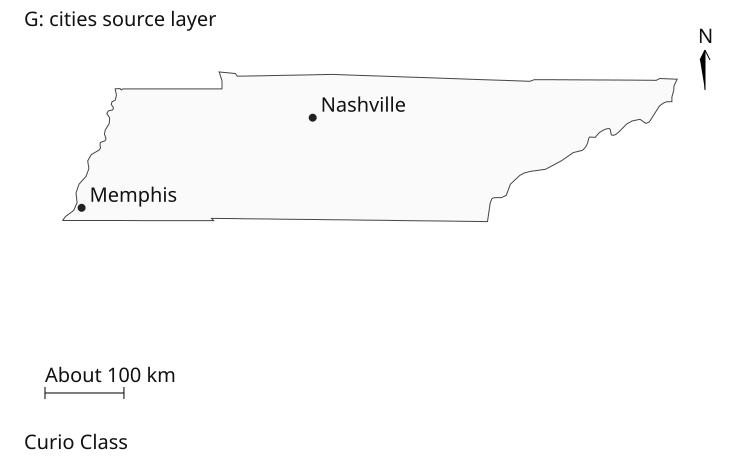

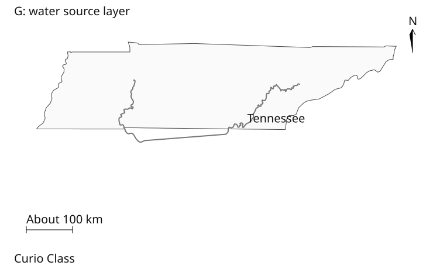

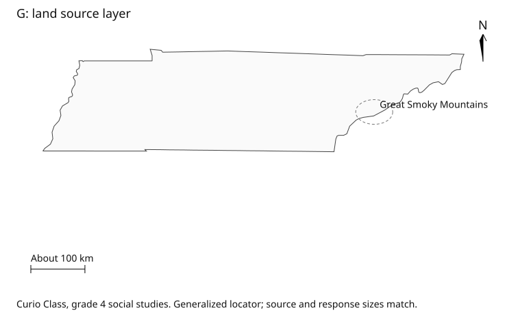

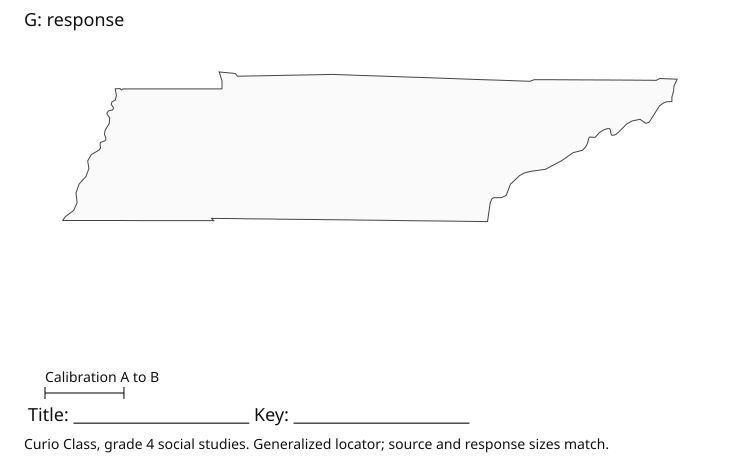

## atlas-H

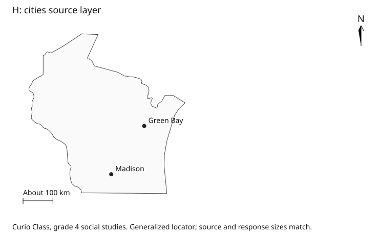

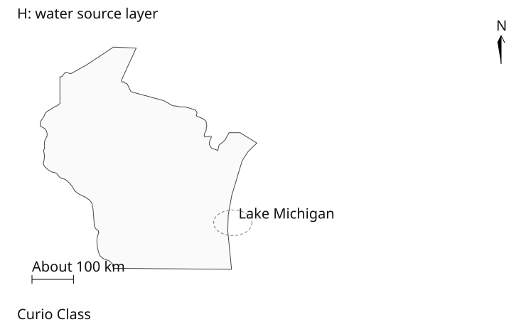

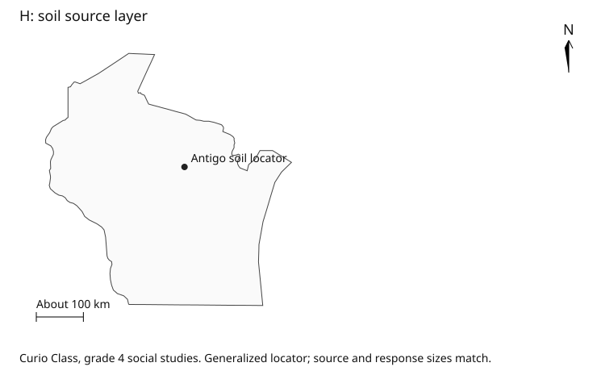

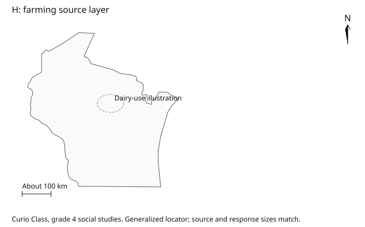

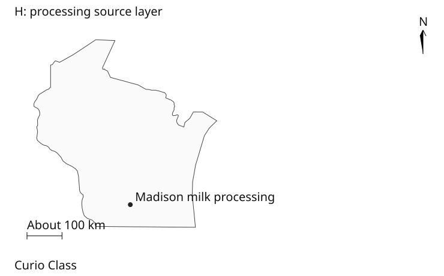

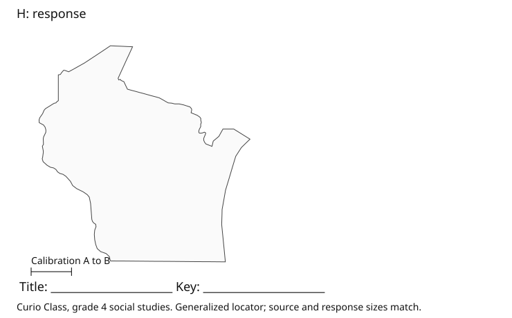

## atlas-I

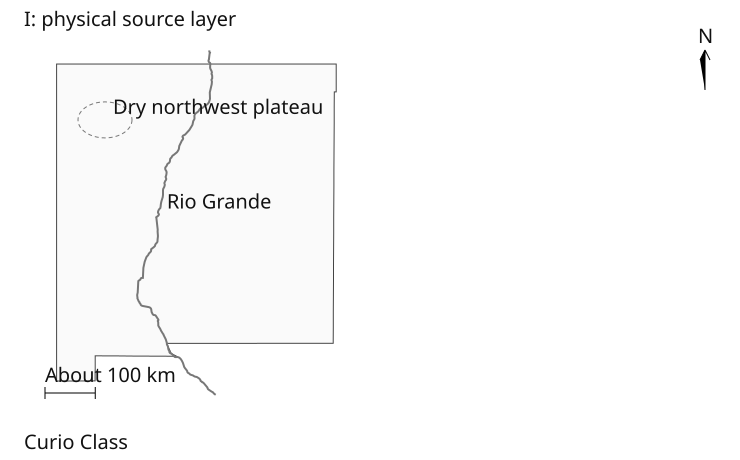

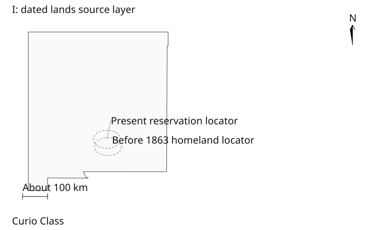

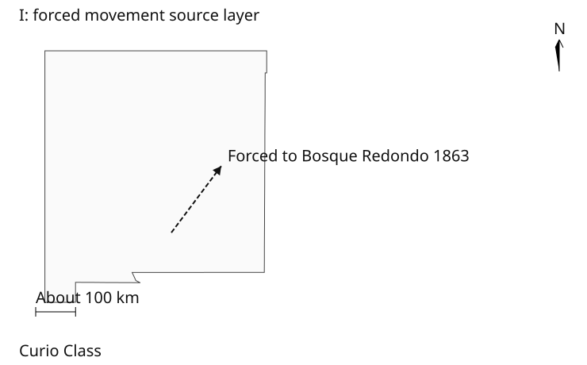

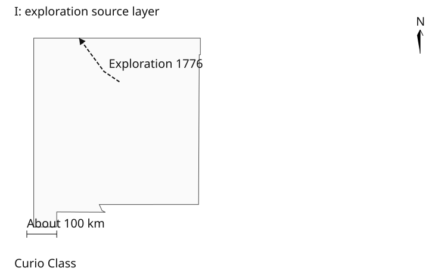

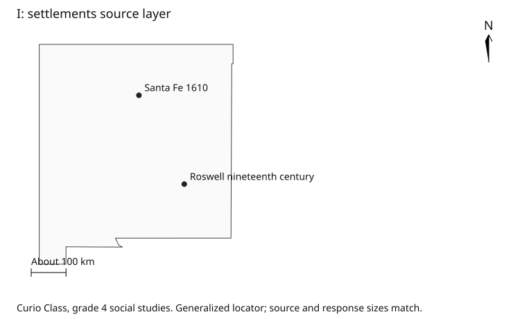

## atlas-J

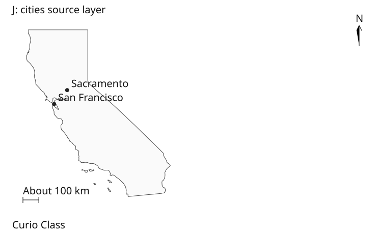

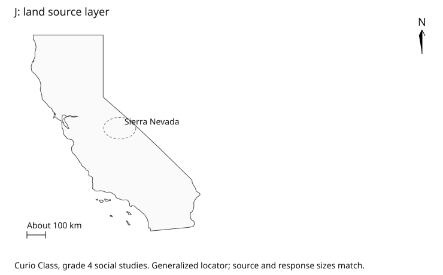

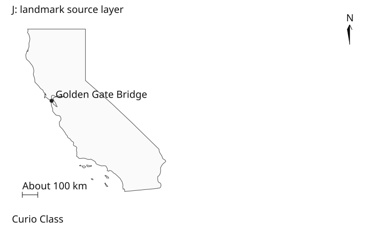

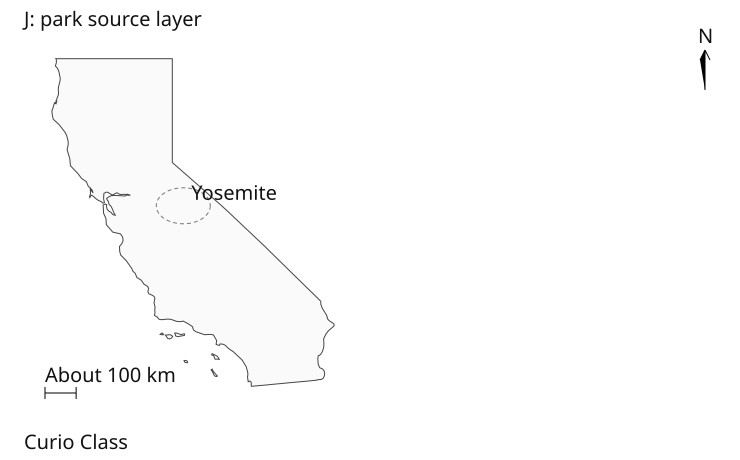

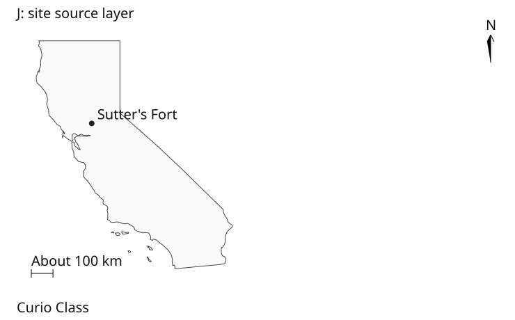

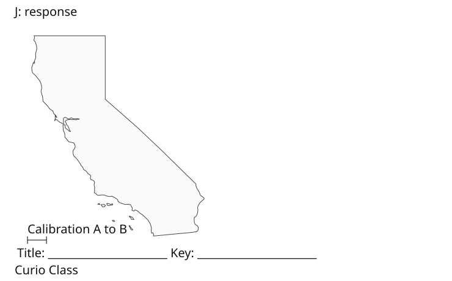

## I captions

The Mescalero Apache homeland extends across the Southwest before 1863. The army forced people to Bosque Redondo in 1863. They left in 1865. Present reservation land differs from both.
Santa Fe is an early Spanish settlement, dated 1610. Roswell has nineteenth-century settler buildings. Native peoples were already there.
The 1776 exploration leaves Santa Fe toward the northwest. New Mexico includes dry plateau country.

## H captions

The Antigo soil locator identifies an area associated with that named soil. The dairy-use symbol is illustrative, not a surveyed farm. Madison has licensed milk processing.

## J captions

The Golden Gate Bridge is a landmark near San Francisco. Yosemite is a national park. Sutter's Fort is a historic site in Sacramento.
