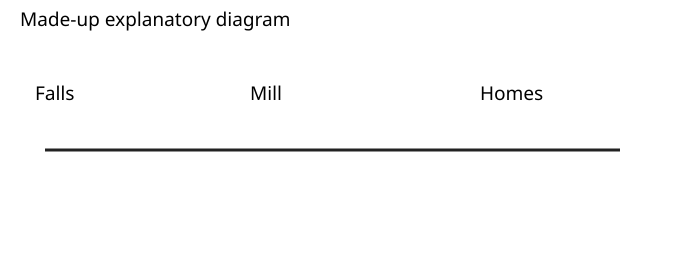

# Day 128 held source record

These records and makers are made up.

A, surveyor's map: falls, a mill beside the falls, and nearby homes.
B, employer notice: Mill workers wanted. Paid work starts Monday.

